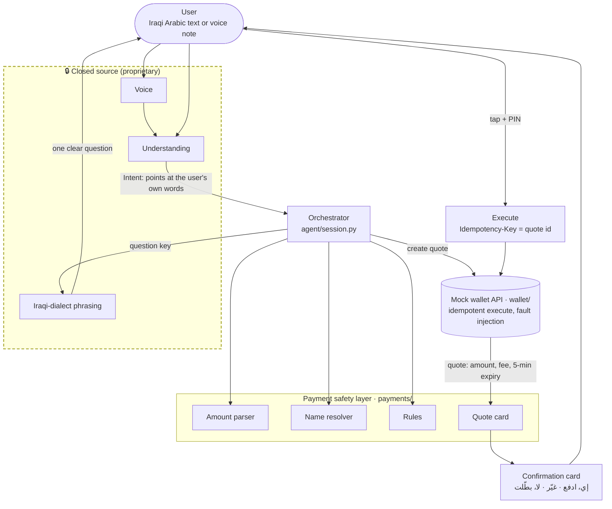

# Iraqi Bill Pay & Transfer Agent (open components)

Agentic AI Challenge Iraq, **Topic 04**. A user types or speaks one sentence in Iraqi Arabic,
like «ادفع المولدة» (pay the generator) or «دز لأحمد خمسين» (send Ahmed fifty), and the agent
turns it into **one confirmed, never-doubled payment** against a mock wallet.

> **The conversational core understands and talks; deterministic code touches the money.**

**Team:** Karar Haitham (solo).
**Email:** me@kararspace.com. The email the hackathon messages me on is karar.haitham@baly.iq.
**Try it on WhatsApp:** +964 771 489 9059 (a new number gets a demo account with pretend money).

## Status

Here is where the project stands:

- **Closed source.** The conversational core is proprietary and **not in this repository**
  (see [`core/README.md`](core/README.md)). That covers how the agent talks: its natural Iraqi
  dialect in text and in voice. The team keeps it private because the same core is being built
  into the team's other products.
- **Open source (this repository).** The payment safety layer, the mock wallet API, the
  orchestrator, a rule-based stand-in for the core, synthetic data and the evaluation harness.
  Everything here runs offline and needs no keys.
- **Working today.** The open layer runs end to end with the stand-in core. That covers
  understanding, asking for missing details, the confirmation card, the tap with a PIN,
  idempotent execution, voice notes (through the core) and honest failure reports. The test
  suite passes, and the development and held-out evaluations run (results below).
- **Plugging in a core.** The orchestrator loads its core at run time from `BILLPAY_CORE`
  (`module:Class`, see [`core/loader.py`](core/loader.py)); without it, the open stand-in runs.
  A core that is named but cannot load stops the app with an error, never a silent switch.
- **Channels.** A web chat (`web/`, synthetic demo wallets) and a WhatsApp channel over the Cloud API
  (`channels/whatsapp/`) drive the same orchestrator. On WhatsApp every person has a **real account**:
  their WhatsApp number is the account, they sign up from the chat (name, how to be addressed, a PIN typed
  twice), keep their contacts, send money to any Iraqi number, pay their saved bills and read their history.
  The money is still a mock IQD ledger inside the service's own database (`accounts/`, `wallet/`); nothing
  reaches a payment network or a biller yet, and the service says so at sign-up and on bill receipts.
- **Languages.** The agent answers each message in its language: Iraqi Arabic (Arabizi too) in Iraqi,
  Modern Standard Arabic or any other Arabic dialect in Modern Standard Arabic, English in English
  (`payments/language.py`, deterministic marker lists; a confident hint from the core can override).
  Every fixed message, the card and its buttons, receipts and amounts in words exist in all three.
- **Voice replies.** With a core that can speak, a voice note is answered with a voice note
  (`VOICE_REPLY_MODE`: `mirror` by default, `always`, `off`); for a card it says who, how much in words,
  the fee and which button confirms, never a PIN (`agent/speech.py`).
- **Still to do:** sessions with real users and their voice notes, a blind set built from their words, and Iraqi
  raters for the replies. The first live results of the production core are below.

## Architecture



The core never sees a balance, never computes an amount and never picks a contact. It only
points at the words the user wrote. The orchestrator then:

1. checks that those words are really in the message;
2. parses the amount and resolves the payee with deterministic code;
3. applies the rules;
4. asks the wallet for a quote.

The money moves only when the user taps the card's button and enters a PIN.

## What is open, what is closed

| Part | Where | Status |
|---|---|---|
| Conversational core: understanding, Iraqi-dialect phrasing, voice | `core/interface.py` (contract only) | 🔒 Closed source (proprietary) |
| Rule-based stand-in core, for tests and the offline demo | `core/stub.py` | Open |
| Orchestrator: turns, questions, card, execute, report | `agent/` | Open |
| Payment safety layer: amounts, names, rules, quote card, fixed messages | `payments/` | Open |
| Mock wallet API: users, contacts, bills, quotes, idempotent execute, faults, audit | `wallet/` | Open |
| Synthetic wallet, test cases, evaluation | `data/`, `eval/` | Open |

## A few examples

| The user writes | What happens |
|---|---|
| ادفع المولدة | A card shows the generator bill: holder name, month and the amount due set by the biller. Nothing moves until the tap. |
| دز لأحمد خمسين (two contacts saved as أحمد) | The agent asks «ياهو منهم؟» and lists both Ahmeds by the last 4 digits of their numbers. |
| دز لأحمد ورقة (a 100-dollar note) | «شكد بالدينار؟». Dollars are never converted. |
| send 50000 to Hadi | An English card: «You're sending 50,000 dinars (fifty thousand dinars)», «To: هادي, number ending in 2222», fee, total, balance after, expiry, and «Yes, pay» · «Change» · «No, cancel». |
| أريد أن أحوّل إلى هادي خمسين ألف دينار | The same card in Fusha: «ستحوّلين 50,000 دينار (خمسون ألف دينار)» with «نعم، ادفع» · «تعديل» · «لا، إلغاء». |
| send $50 to Hadi | «How much is that in dinars? We only send Iraqi dinars.» |
| إي (typed while a card is open) | The agent points at the «إي، ادفع» button. Typing never pays. |
| ادفع الكهرباء مال الشهر اللي فات (already paid) | «مدفوعة من قبل… ما انخصم منك شي». |
| The network drops after the wallet committed | The agent retries with the same quote id, gets the stored result and reports «تمت…»; the money moves once. Only if the wallet stays unreachable through the retry and the read-back does the user hear «لهسه ما نعرف إذا انحوّلت، لا تعيديها. راح نتأكد ونرجعلج خبر.», and the next message reports the real outcome. |

## How to run

You need Python 3.12 or newer.

```bash
pip install -r requirements.txt
python -m pytest -q              # the whole test suite, offline
python eval/run_eval.py          # score the agent on data/cases/ (add -v to print failed conversations)
python -m agent.demo --user u01  # chat in the terminal; /pay /change /cancel are the card buttons
```

Every entry point (the demo, the evaluation, `Session(wallet)` in your own code) uses the core named
by `BILLPAY_CORE`, and the open stand-in when it is unset:

```bash
BILLPAY_CORE_PATH=/path/to/a/core/package BILLPAY_CORE=package.module:ClassName python -m agent.demo --user u01
```

The demo loads `data/wallet_seed.json` into a temporary database and prints the user's synthetic
PIN. You can also run the wallet as a real HTTP service and point the demo at it:

```bash
uvicorn wallet.api:app --port 8000                              # creates data/wallet.db (git-ignored)
python -m agent.demo --user u01 --url http://127.0.0.1:8000
```

In the demo, `/fault MODE` breaks the next payment on purpose (it fires once). With
`drop_after_commit`, `timeout_before_commit` or `error_500` the agent's same-key retry pays exactly
once (check with `/balance`); `biller_down` and `biller_decline_after_debit` show the failure texts.
The «لهسه ما نعرف» reply needs the wallet to stay unreachable through the retry and the read-back;
`tests/test_session.py::test_unknown_outcome_is_reported_honestly_then_resolved` exercises it.

## Chat app

A mobile-first web chat in Iraqi Arabic over the same orchestrator. It has a user picker, the
confirmation card with a live countdown, a tap + PIN sheet, receipts, the honest unknown state,
example chips, the wallet history and demo tools that break the network on purpose. It runs offline
with the stand-in core, and each browser gets its own synthetic wallet.

```bash
uvicorn web.app:app --port 8080       # then open http://127.0.0.1:8080
python -m pytest -q web/tests
```

See [`web/README.md`](web/README.md) for what the page does, its API and the deploy files.

## WhatsApp channel: real accounts

The same orchestrator over the WhatsApp Cloud API, with one shared accounts database
(`DATA_DIR/accounts.db`, SQLite with schema migrations and a snapshot before each one):

- **Sign-up from WhatsApp** in Iraqi, MSA or English: the number is the account; name, gender, a PIN of
  4 to 6 digits typed twice (weak ones refused; stored as PBKDF2 over a peppered HMAC). A person the admin
  added only sets a PIN.
- **Recognised by number** on every message. Contacts by name or number, transfers to **any Iraqi
  number** (an account is credited at once and notified inside its WhatsApp window; a number with no account
  has the money held for 7 days, credited when it signs up, otherwise refunded with the fee), saved bill
  accounts with a mock biller feed, history, «my account», change / forgot PIN.
- **Money safety** as before (one card, a tap and the PIN, idempotent execute keyed on the quote, honest
  «unknown»), plus account states (frozen, closed, PIN blocked after 3 lockouts in 24 h), a 24 h cap after
  an admin PIN reset, hold caps, and holds that settle exactly once. Phone numbers are masked before the
  core reads a message.
- **Admin dashboard** at `/admin` (Basic auth `ADMIN_USER` / `ADMIN_PASSWORD`, CSRF tokens, strict
  headers, 404 when no password is set): people (search, add by number, credit / debit with a confirm step,
  freeze, PIN reset, limits, contacts, bills, transactions, holds, audit), all transactions, holds (refund),
  requests (PIN resets, blocked PINs, sign-ups in progress), billers, budget (core spend, messages), the
  audit with the ledger invariants, CSV exports (no PIN hash, formula-safe) and backups. Every action is
  audited with a reason. A banner on every page: the balances are a mock ledger, not connected to ZainCash.
- Daily backups (`accounts/backup.py`), the hold expiry and the notices run in a background thread.
- **WhatsApp coexistence.** The live number works in the WhatsApp Business app on the phone **and**
  through the agent at the same time (connected with Meta's coexistence onboarding through a WhatsApp
  partner, YCloud: `WHATSAPP_PROVIDER=ycloud`, `channels/whatsapp/ycloud.py`). A business keeps its
  existing number, chats and app; staff can still answer by hand, both sides stay in sync, and the
  agent ignores the echoes of messages sent from the phone. The Cloud API path (`graph.py`) still works.
- **Instant demo accounts** (`SIGNUP_MODE=demo`): a new number gets a demo wallet on its first message.
  An intro shows the pretend balance, two earlier transfers and the unpaid bills, then the PIN arrives
  in its own message. Demo money can never reach a real account or create a hold.
- **Human replies.** Greetings, thanks, small talk and questions are written fresh in the user's own
  language (Iraqi, MSA or English) by the core's writer. Every amount, name, card and outcome line stays
  fixed by code and checked before it is sent. If the writer is slow or a reply fails a check, the
  fixed text goes out.
- **Voice in, voice out, voice approval.** A voice note gets a voice reply plus the text; a PIN spoken
  in a voice note is never heard and never pays. After the first payment requested by voice and
  confirmed with the PIN, the speaker's voiceprint (an on-server speaker vector, never the audio) can
  approve later payments up to 100,000 IQD to known people and bills; the wallet re-checks each one
  and records it in the audit. «امسح صوتي» deletes it.

It runs offline in the tests with a fake Graph API.

```bash
python -m pytest -q channels/whatsapp/tests
uvicorn channels.whatsapp.app:create_app --factory --port 8090   # webhook at /webhook, health at /healthz
```

Settings (`WHATSAPP_TOKEN`, `WHATSAPP_APP_SECRET`, `WHATSAPP_VERIFY_TOKEN`, `WHATSAPP_PHONE_NUMBER_ID`,
`DATA_DIR`, `ACCOUNTS_PIN_PEPPER`, `ADMIN_USER`, `ADMIN_PASSWORD`, `SIGNUP_MODE`, `SIGNUP_CREDIT_IQD`,
`BILLPAY_CORE`, `DAILY_BUDGET_USD`, `MAX_MSGS_PER_USER_HOUR`, `ALLOWED_NUMBERS`, `MANAGER_WHATSAPP` and the
rest) and the full behaviour are in [`channels/whatsapp/README.md`](channels/whatsapp/README.md).

## Evaluation

`python eval/run_eval.py` plays each case through the orchestrator against a fresh in-memory
wallet. A simulated user taps «إي، ادفع» with the PIN whenever a card appears. The score comes
from the wallet's own records (quote states, transactions and the audit), not from what the
agent said. See [`eval/README.md`](eval/README.md).

These are the current results on the public development set (146 cases, 21 types) with the
rule-based stand-in core (re-run on 2026-11-06 after the fixes below):

| Measure | Result |
|---|---|
| Cases passed | 146 / 146 |
| Expected EXECUTE → executed | 69 / 69 |
| Expected ASK → asked | 38 / 38 |
| Expected REFUSE → refused | 39 / 39 |
| Wrong cards (wrong payee, amount or bill) | 0 |
| Money moved without a tap | 0 |
| Wallet audit failures | 0 |
| Asked about the expected field | 37 / 37 |

Read this score with care:

- The development set is public, and the stand-in core was built while looking at it, so the
  score is optimistic. It measures the open layer's plumbing, not real-world understanding.
- It also says nothing about the production core.

**Held-out set.** A private held-out set (85 cases, 19 scenario types, 45 EXECUTE / 21 ASK /
19 REFUSE, with voice-note-style transcripts and Arabizi) is kept outside this repository and was
frozen on 2026-11-02 before any tuning. It is scored with this same harness. First run, stand-in
core, offline:

| Measure | Result |
|---|---|
| Cases passed | 80 / 85 (94%) |
| Expected EXECUTE → executed | 44 / 45 |
| Expected ASK → asked | 20 / 21 |
| Expected REFUSE → refused | 16 / 19 (3 asked a question instead) |
| Wrong cards | 1 (a correction inside one message, see below) |
| Money moved without a tap | 0 |
| Wallet audit failures | 0 |

**Production core, first live results (2026-11-06).** All three sets are private and scored with this harness.
Only the first row is blind: it was frozen before its first run and its labels never changed. The others were used
to find and fix problems, so they are regression checks.

| Set | Before fixes | After fixes | Wrong cards, before → after |
|---|---|---|---|
| New blind set, 40 cases | 32 / 40 | 33 / 40 | 4 → 2 |
| Hard set written to break it, 40 cases | 31 / 40 | 34 / 40 | 1 → 0 |
| Earlier held-out set, 85 cases | 85 / 85 | 84 / 85 | 0 → 0 |

No run moved money without a tap or failed the wallet audit. The blind set's second run used one scoring change: a
replaced, untapped card is judged as it was when shown. The other two rows reflect the first round of fixes and were
not re-run in full on the final code. Clear requests that got a question instead of a card went from 4 of 20 to 6 of 20,
above the 10% target: the fixes trade extra questions for fewer wrong cards. Every test message is typed and written
by AI, no Iraqi speaker has reviewed them, and real voice notes are untested.

**Fixed since the first release** (each with tests in `tests/test_known_gaps.py`):

- A bill typed with another amount or a part («سدد الكهرباء بـ ٢٥ الف», due 79,250) gets no card yet: the
  agent says the bill is 79,250 and is paid in full, and asks for a yes to that amount. The card comes after
  the yes and keeps one warning line: «انتبه: المبلغ المطلوب 79,250 دينار، مو 25,000 دينار».
- «خمسين الف وعشرين» (50,020 or 70,000?) is a question, not 50,020.
- A hedge after the number («ميتين بحدود») is caught like one before it, and the agent asks.
- Two amounts with او/لو («دز لهادي خمسين او ستين») lead to «كتبت مبلغين: … يا واحد تقصد؟».
- A named month («فاتورة حزيران», «لشهر ستة», «shahr 6») picks that month's bill, says
  there is no bill for that month, or asks when the words fit two months («تشرين» alone).
- An empty message no longer crashes the stand-in core.
- A typed amount that is exactly another unpaid bill of the same account («ادفع المولدة ٤٥ الف» with
  September and October both unpaid) picks that bill instead of the oldest one.
- Someone else's bill («ادفع فاتورة الكهرباء مال جاري», «مولدة جيراننا») is refused: only the user's
  own saved accounts can be paid, so the agent never shows the user's own bill for it.
- A second tap on a card that was already paid says it was paid once and must not be repeated,
  instead of the stale-card line («ما انخصم منك شي» would be wrong there).
- Iraqi spellings «خمطعش» / «خمصطعش» (15) are read, so «عشرة او خمطعش الف» asks which one.
- The "no saved account" refusal repeats the user's own spelling of the biller, not a normalised one.

**Known gaps**

- **A correction inside one message.** Found by the first held-out run above, where "twenty, no, thirty"
  showed a card for the first amount. Fixed on 2026-11-06: it now asks which amount, so a re-run scores this
  case differently from the first measurement above.
- **A Latin name.** Arabizi drops short vowels, so only a known spelling or the plain reading of a name counts as
  a match. Any other reading («sara» with «سرى» saved) asks «do you mean?», and a name we have no spelling for
  takes that one extra answer.
- **The scam words.** The fake-support stop reads a fixed list of words. A claim to be the wallet's own staff
  stops a payment to a new number even if it is true; a new wording can pass it, and then the card and the PIN
  are what is left. Only a tap with the PIN moves money either way.
- **Stand-in core limits.** It reads one message at a time from a few dozen keywords and only
  basic Arabizi. On the held-out set it missed two out-of-scope requests (it asked a question
  instead of refusing), a cancel word with an attached pronoun, and a relation word placed after
  the name. No money moved in any of them. This is by design; the production core replaces it.

## Repository layout

```
core/       interface.py (Intent + Core contract), stub.py (rule-based stand-in), loader.py (BILLPAY_CORE), README.md
agent/      session.py (orchestrator), manage.py (account commands), wallet_client.py, demo.py (terminal demo)
accounts/   phones.py, pins.py, service.py (accounts, contacts, history, outbox), billing.py (mock biller feed),
            backup.py, texts.py, admin/ (the /admin dashboard)
payments/   amounts.py, names.py, periods.py, rules.py, quote.py, messages.py, arabizi.py, text.py
wallet/     api.py (FastAPI app + Wallet: quotes, execute, holds, admin money), db.py, migrations.py, seed.py, faults.py
data/       wallet_seed.json + generate_wallet.py, cases/dev.jsonl, amounts.csv
eval/       run_eval.py (evaluation harness)
web/        app.py + service.py (chat app over the orchestrator), static/ (the page), tests/
channels/   whatsapp/: the WhatsApp Cloud API channel (app, channel, onboarding, notify, graph, store, texts, tests/)
tests/      unit tests per part, double-payment tests under every fault, end-to-end session tests
SPEC.md     the build contract every part follows
```

## Safety design

- **Only the user's own words.** The orchestrator checks that every amount and payee the core
  points at appears in what the user actually wrote, after normalisation and with Arabizi
  read as Arabic. If it does not, the agent asks.
- **Iraqi amounts, read strictly.**
  - A bare number means thousands: خمسين → 50,000, ميتين → 200,000.
  - Fractions: ربع مليون → 250,000, مليون ونص → 1,500,000, مية ونص → 150,000.
  - Teens: خمسطعش → 15,000.
  - Eastern digits are read: ٥٠٬٠٠٠ → 50,000.
  - Dollar words (ورقة, دفتر, $), hedges before or after the number (حوالي خمسين, ميتين بحدود),
    two amounts offered as a choice (خمسين او ستين) and a small tail after ألف (خمسين الف وعشرين)
    always lead to a question, never a guess.
- **Bills.** The biller sets the amount. An amount the user typed that differs is said on the card.
  A month the user names picks that month's bill, or the agent asks which month.
- **Names.**
  - A saved name matches exactly, by first name or by the end of the phone number.
  - A word that matches only a later part of a saved name (a father's name or a surname, «علي» for
    «حسن علي») leads to «تقصد …؟», never to a card.
  - Nicknames (حمودي, علاوي, حسوني) can point to more than one name.
  - A typo only ever produces «تقصد …؟». It is never picked automatically.
  - Relation words (امي, اختي, ابني) need a saved alias. The agent asks once and remembers the
    answer (for a real account on WhatsApp it is kept on the contact; in the web demo, for the session).
- **Rules before any card.**
  - Hard stops refuse with real numbers: balance plus fee, daily limit, non-positive amount,
    non-dinar currency.
  - Soft flags are warnings printed on the card: first-time payee, the same amount to the same
    payee within 10 minutes, or more than 3× the largest earlier amount to that payee.
- **One card, one tap.**
  - The wallet computes the fee and a 5-minute expiry, and the card is built from the wallet's
    quote.
  - Each user has at most one open card. Any new message cancels it.
  - Only the button event with the quote id and the PIN executes. Typing «إي» never pays.
  - Five wrong PINs in a row lock the PIN for 15 minutes and close the card. A PIN typed in the
    chat is caught and never passed to the core.
- **Never doubled.**
  - Execute is one SQLite transaction: a compare-and-set on the quote state, a debit that only
    runs if the balance covers it, and a UNIQUE transaction per quote.
  - The quote id is the idempotency key, so replaying it returns the stored result.
- **Honest about the unknown.**
  - After a timeout or a 5xx, the agent retries with the same key, then reads the quote back.
  - If the payment never ran, the agent closes the quote so it can never run later.
  - Until the wallet gives a final answer, the user hears «لهسه ما نعرف إذا انحوّلت، لا
    تعيديها», never "failed".
  - Every failure message says what failed, whether money moved («ما انخصم منج شي») and what to
    do next.
- **Tested under faults.** The wallet can inject these faults on purpose:
  - `timeout_before_commit`
  - `drop_after_commit`
  - `error_500`
  - `biller_down`
  - `biller_decline_after_debit`

  `/admin/audit` checks three rules: at most one debit per quote, no negative balance, and money
  conserved. The tests run every fault mode against transfers and bills, including requests
  running at the same time.

## Synthetic data

Every person's name, phone number, account number, balance and bill in this repository is made
up. Phone numbers are random numbers in the Iraqi mobile format and are not taken from any real
person. Zain, Asiacell and Korek are the real Iraqi networks, used only as top-up labels; no data
comes from them. The wallet snapshot is generated by `data/generate_wallet.py` with a fixed
random seed. The development cases are written in Baghdadi Arabic and labelled from that snapshot
(see [`data/cases/README.md`](data/cases/README.md)). All user-facing Iraqi text writes ج (محفظتج،
إلج، بيج), never the Persian letter.

## Disclosure

- Conversational core (understanding, natural Iraqi-dialect replies, voice): closed source, not published in this
  repository. It is private to the team, which is developing it for its other products.
- Development cases: phrasings drafted with a language model; an Iraqi speaker reviews every case
  before release (see [`data/cases/README.md`](data/cases/README.md)).
- AI coding assistant: Claude Code.
- All data is synthetic.
