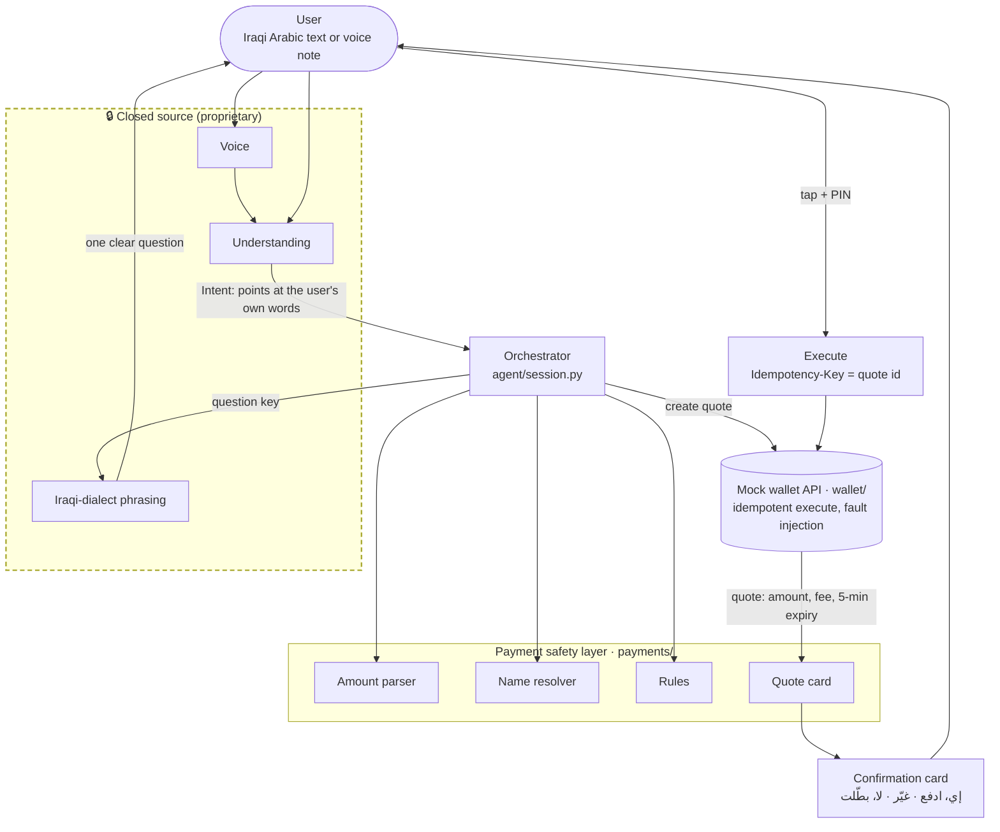

# Iraqi Bill Pay & Transfer Agent (open components)

Agentic AI Challenge Iraq, **Topic 04**. A user types or speaks one sentence in Iraqi Arabic,
like «ادفع المولدة» (pay the generator) or «دز لأحمد خمسين» (send Ahmed fifty), and the agent
turns it into **one confirmed, never-doubled payment** against a mock wallet.

> **The conversational core understands and talks; deterministic code touches the money.**

## Status

Here is where the project stands:

- **Closed source.** The conversational core handles language understanding, Iraqi-dialect
  phrasing and voice notes. It is adapted from our Iraqi-dialect WhatsApp agent.
  It is proprietary and **not in this repository** (see [`core/README.md`](core/README.md)).
- **Open source (this repository).** The payment safety layer, the mock wallet API, the
  orchestrator, a rule-based stand-in for the core, synthetic data and the evaluation harness.
  Everything here runs offline and needs no keys.
- **Working today.** The open layer runs end to end with the stand-in core. That covers
  understanding, asking for missing details, the confirmation card, the tap with a PIN,
  idempotent execution and honest failure reports. The test suite passes, and the development
  evaluation runs (results below).
- **MVP work still to do:**
  - connect the production core to this layer end to end;
  - build a chat UI;
  - run the held-out evaluation.

## Architecture



The core never sees a balance, never computes an amount and never picks a contact. It only
points at the words the user wrote. The orchestrator then:

1. checks that those words are really in the message;
2. parses the amount and resolves the payee with deterministic code;
3. applies the rules;
4. asks the wallet for a quote.

The money moves only when the user taps the card's button and enters a PIN.

## What is open, what is closed

| Part | Where | Status |
|---|---|---|
| Conversational core: understanding, Iraqi-dialect phrasing, voice | `core/interface.py` (contract only) | 🔒 Closed source (proprietary) |
| Rule-based stand-in core, for tests and the offline demo | `core/stub.py` | Open |
| Orchestrator: turns, questions, card, execute, report | `agent/` | Open |
| Payment safety layer: amounts, names, rules, quote card, fixed messages | `payments/` | Open |
| Mock wallet API: users, contacts, bills, quotes, idempotent execute, faults, audit | `wallet/` | Open |
| Synthetic wallet, test cases, evaluation | `data/`, `eval/` | Open |

## A few examples

| The user writes | What happens |
|---|---|
| ادفع المولدة | A card shows the generator bill: holder name, month and the amount due set by the biller. Nothing moves until the tap. |
| دز لأحمد خمسين (two contacts saved as أحمد) | The agent asks «ياهو منهم؟» and lists both Ahmeds by the last 4 digits of their numbers. |
| دز لأحمد ورقة (a 100-dollar note) | «شكد بالدينار؟». Dollars are never converted. |
| إي (typed while a card is open) | The agent points at the «إي، ادفع» button. Typing never pays. |
| ادفع الكهرباء مال الشهر اللي فات (already paid) | «مدفوعة من قبل… ما انخصم منك شي». |
| The network drops after the wallet committed | The agent retries with the same quote id, gets the stored result and reports «تمت…»; the money moves once. Only if the wallet stays unreachable through the retry and the read-back does the user hear «لهسه ما نعرف إذا انحوّلت، لا تعيديها. راح نتأكد ونرجعلج خبر.», and the next message reports the real outcome. |

## How to run

You need Python 3.12 or newer.

```bash
pip install -r requirements.txt
python -m pytest -q              # the whole test suite, offline
python eval/run_eval.py          # score the agent on data/cases/ (add -v to print failed conversations)
python -m agent.demo --user u01  # chat in the terminal; /pay /change /cancel are the card buttons
```

The demo loads `data/wallet_seed.json` into a temporary database and prints the user's synthetic
PIN. You can also run the wallet as a real HTTP service and point the demo at it:

```bash
uvicorn wallet.api:app --port 8000                              # creates data/wallet.db (git-ignored)
python -m agent.demo --user u01 --url http://127.0.0.1:8000
```

In the demo, `/fault MODE` breaks the next payment on purpose (it fires once). With
`drop_after_commit`, `timeout_before_commit` or `error_500` the agent's same-key retry pays exactly
once (check with `/balance`); `biller_down` and `biller_decline_after_debit` show the failure texts.
The «لهسه ما نعرف» reply needs the wallet to stay unreachable through the retry and the read-back;
`tests/test_session.py::test_unknown_outcome_is_reported_honestly_then_resolved` exercises it.

## Evaluation

`python eval/run_eval.py` plays each case through the orchestrator against a fresh in-memory
wallet. A simulated user taps «إي، ادفع» with the PIN whenever a card appears. The score comes
from the wallet's own records (quote states, transactions and the audit), not from what the
agent said. See [`eval/README.md`](eval/README.md).

These are the current results on the public development set (111 cases, 19 types) with the
rule-based stand-in core:

| Measure | Result |
|---|---|
| Cases passed | 111 / 111 |
| Expected EXECUTE → executed | 57 / 57 |
| Expected ASK → asked | 25 / 25 |
| Expected REFUSE → refused | 29 / 29 |
| Wrong cards (wrong payee, amount or bill) | 0 |
| Money moved without a tap | 0 |
| Wallet audit failures | 0 |
| Asked about the expected field | 24 / 24 |

Read this score with care:

- The development set is public, and the stand-in core was built while looking at it, so the
  score is optimistic. It measures the open layer's plumbing, not real-world understanding.
- It also says nothing about the production core.
- The held-out set is not in this repository. Running it is part of the MVP work.
- A quick check with new phrasings found gaps; they are listed below.

**Known gaps**

- **Ambiguous amount after ألف.** «خمسين الف وعشرين» is read as 50,020; it should be a
  question. The card shows the amount in digits and in words before any tap.
- **Hedge after the number.** A hedge word after the number («ميتين بحدود») is not caught.
  One before it («حوالي ميتين») is, and the agent asks for the exact amount.
- **Two amounts with او/لو.** «دز لهادي خمسين او ستين» gives a 50,000 card instead of asking
  which amount. The card shows the amount before any tap.
- **A named month is ignored.** «ادفع النت مال شهر ستة» shows the current month's bill. The card
  shows the month before any tap.
- **Stand-in core limits.** It reads one message at a time from a few dozen keywords and only
  basic Arabizi. This is by design; the production core replaces it.

## Repository layout

```
core/       interface.py (Intent + Core contract), stub.py (rule-based stand-in), README.md (closed-core notice)
agent/      session.py (orchestrator), wallet_client.py (in-process or HTTP client), demo.py (terminal demo)
payments/   amounts.py, names.py, rules.py, quote.py, messages.py, arabizi.py, text.py
wallet/     api.py (FastAPI app), db.py (SQLite schema), seed.py, faults.py
data/       wallet_seed.json + generate_wallet.py, cases/dev.jsonl, amounts.csv
eval/       run_eval.py (evaluation harness)
tests/      unit tests per part, double-payment tests under every fault, end-to-end session tests
SPEC.md     the build contract every part follows
```

## Safety design

- **Only the user's own words.** The orchestrator checks that every amount and payee the core
  points at appears in what the user actually wrote, after normalisation and with Arabizi
  read as Arabic. If it does not, the agent asks.
- **Iraqi amounts, read strictly.**
  - A bare number means thousands: خمسين → 50,000, ميتين → 200,000.
  - Fractions: ربع مليون → 250,000, مليون ونص → 1,500,000, مية ونص → 150,000.
  - Teens: خمسطعش → 15,000.
  - Eastern digits are read: ٥٠٬٠٠٠ → 50,000.
  - Dollar words (ورقة, دفتر, $) and hedges (حوالي) always lead to a question, never a guess.
- **Names.**
  - A saved name matches exactly, by first name or by the end of the phone number.
  - A word that matches only a later part of a saved name (a father's name or a surname, «علي» for
    «حسن علي») leads to «تقصد …؟», never to a card.
  - Nicknames (حمودي, علاوي, حسوني) can point to more than one name.
  - A typo only ever produces «تقصد …؟». It is never picked automatically.
  - Relation words (امي, اختي, ابني) need a saved alias. The agent asks once and remembers the
    answer for the rest of the session (in memory; the mock wallet does not store new aliases).
- **Rules before any card.**
  - Hard stops refuse with real numbers: balance plus fee, daily limit, non-positive amount,
    non-dinar currency.
  - Soft flags are warnings printed on the card: first-time payee, the same amount to the same
    payee within 10 minutes, or more than 3× the largest earlier amount to that payee.
- **One card, one tap.**
  - The wallet computes the fee and a 5-minute expiry, and the card is built from the wallet's
    quote.
  - Each user has at most one open card. Any new message cancels it.
  - Only the button event with the quote id and the PIN executes. Typing «إي» never pays.
  - Five wrong PINs in a row lock the PIN for 15 minutes and close the card. A PIN typed in the
    chat is caught and never passed to the core.
- **Never doubled.**
  - Execute is one SQLite transaction: a compare-and-set on the quote state, a debit that only
    runs if the balance covers it, and a UNIQUE transaction per quote.
  - The quote id is the idempotency key, so replaying it returns the stored result.
- **Honest about the unknown.**
  - After a timeout or a 5xx, the agent retries with the same key, then reads the quote back.
  - If the payment never ran, the agent closes the quote so it can never run later.
  - Until the wallet gives a final answer, the user hears «لهسه ما نعرف إذا انحوّلت، لا
    تعيديها», never "failed".
  - Every failure message says what failed, whether money moved («ما انخصم منج شي») and what to
    do next.
- **Tested under faults.** The wallet can inject these faults on purpose:
  - `timeout_before_commit`
  - `drop_after_commit`
  - `error_500`
  - `biller_down`
  - `biller_decline_after_debit`

  `/admin/audit` checks three rules: at most one debit per quote, no negative balance, and money
  conserved. The tests run every fault mode against transfers and bills, including requests
  running at the same time.

## Synthetic data

Every person's name, phone number, account number, balance and bill in this repository is made
up. Phone numbers are random numbers in the Iraqi mobile format and are not taken from any real
person. Zain, Asiacell and Korek are the real Iraqi networks, used only as top-up labels; no data
comes from them. The wallet snapshot is generated by `data/generate_wallet.py` with a fixed
random seed. The development cases are written in Baghdadi Arabic and labelled from that snapshot
(see [`data/cases/README.md`](data/cases/README.md)). All user-facing Iraqi text writes ج (محفظتج،
إلج، بيج), never the Persian letter.

## Disclosure

- Conversational core: closed source, not published in this repository.
- Development cases: phrasings drafted with a language model; an Iraqi speaker reviews every case
  before release (see [`data/cases/README.md`](data/cases/README.md)).
- AI coding assistant: Claude Code.
- All data is synthetic.
