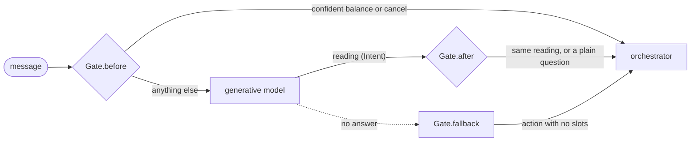

# Decision models (`decision/`)

A decision model picks **one answer from a fixed list**. It cannot write a sentence, invent an amount or make up a
name: the only thing it can say is one of the labels it was trained on, with a confidence.

The model here, `intent_v1`, reads one message and picks one of the nine actions in `core.interface.ACTIONS`
(`pay_bill`, `transfer`, `topup`, `balance`, `cancel`, `unsupported`, `chat`, `history`, `add_contact`).

```python
from decision import IntentModel, Gate

IntentModel.load().predict("شكد رصيدي")      # Decision(label="balance", confidence=1.0, scores={...})
Gate().before("شكد رصيدي", context)          # Intent("balance"): answered with no generative call
```

## Why a decision model and not only a generative one

| | The decision model | A generative model |
|---|---|---|
| What it can output | one of nine labels and a number | any text |
| Where it runs | inside the agent's own process, standard library only | a hosted or local model server |
| Cost per message | nothing | tokens, or a machine with a GPU |
| Time per message | about 0.2 ms (measured on a laptop) | hundreds of milliseconds to seconds |
| Data leaving the machine | none | the message, unless the model is local |
| Size | one 437 KB JSON file | gigabytes |
| What it cannot do | fill a slot (who, how much, which bill), follow a conversation, phrase a reply | |

Picking from a fixed list is a classification job, so a classifier does it: the smallest model that passes the
tests. The generative model keeps the jobs only it can do (pointing at the payee and the amount in the user's
words, reading a message in its conversation, phrasing). Neither model touches money. Code computes amounts, fees
and limits, and only a tap on the card's button with the PIN moves anything.

## Where it sits: before, after, and instead of the generative model



| Position | What it does | What it can never do |
|---|---|---|
| `Gate.before(text, context)` | A message that is, with confidence 0.90 or more, a request with nothing to fill in (today: `balance`, `cancel`) is answered at once. No generative call, no cost, nothing leaves the machine. | Return a payment action. The list of direct actions is cut down to `balance`, `history`, `cancel` in code, whatever the caller or the model file says. |
| `Gate.after(text, intent, context)` | Cross-checks the generative reading. If one model says "a payment" and the decision model is at least 0.86 sure of the opposite, the reading is dropped and the orchestrator asks. It returns the evidence too: `{"decision", "confidence", "generative", "verdict": "agree" / "ask" / "direct" / "abstain", "payment_probability"}`. | Create a payment request, or set or change an amount, a payee, a biller or a currency. It returns the very Intent it was given, untouched, or a new `Intent("chat")` with no slot filled. |
| `Gate.fallback(text, context)` | When no generative model answered at all: the decision model's action (confidence 0.50 or more) with **no slots**, so the orchestrator asks who and how much with its own fixed questions. Otherwise a plain `Intent("chat")`. | Fill a slot. |

Rules that hold in all three places:

- **Inside an open question or with an open card the gate steps aside.** When `context["asking"]` or
  `context["pending_action"]` is set, the message is an answer («خمسين», «الثاني»), not a new request:
  `before` returns `None`, `after` returns the reading untouched, and `fallback` recognises only a clear cancel.
- **Two requests in one message.** The model gives one label, so the gate reads the message a second time in
  parts (every leading and every trailing run of words). `before` answers only when no part reads as a different
  request, and `after` does not overrule a payment reading when a part reads as a payment. A message over 12 words
  is never answered directly; a payment reading of a message over 40 words is never overruled.
- **A stop, a refusal and a question are never overruled.** When the generative model says `cancel`,
  `unsupported` or `chat`, `after` leaves it alone even if the decision model says "payment": those readings move
  nothing and start nothing.
- **A disagreement needs confidence.** Below the threshold the verdict is `abstain` and nothing changes.

`tests/test_decision_gate.py` checks these with property tests over random readings, random thresholds and a
fake model, and on every train and tune line with the real one.

The thresholds live in the model file (`"gate"` in `models/intent_v1.json`) and are read from there;
`Gate(direct=..., veto=..., floor=..., part=..., direct_actions=...)` overrides them.

## The model

- **Text preparation** (`features.py`): letters folded with `payments.text.fold` (alef and ya forms, ta marbuta,
  Eastern digits, diacritics, stretched letters), every digit written `0` (the model picks an action, it never
  reads an amount), a masked phone number (`هاتف_ا`) given the shape of a real one, and for a message with Latin
  letters its Arabic reading appended (`payments.arabizi.to_arabic`), so Arabizi shares its n-grams with Arabic.
- **Features**: character n-grams of 1 to 5 letters inside word boundaries, TF-IDF with sublinear term
  frequency, the 5,000 most frequent n-grams.
- **Classifier**: multinomial logistic regression (C = 300, balanced class weights).
- **Confidence**: one temperature (0.92), fitted on predictions for train lines made by models that had not seen
  them (5 folds), then folded into the weights.
- **Inference** (`intent.py`): pure Python, standard library only. The file is parsed on first use (about 20 ms),
  then a prediction takes about 0.2 ms. A test rebuilds the scikit-learn pipeline from the model file and
  compares probabilities on 200 tune lines (limit 1e-6, measured 1e-15); a second test does the same against
  numbers stored at training time, so it runs without scikit-learn.

scikit-learn 1.9.0 and numpy are needed only to train (`train.py`). Nothing the agent imports at run time needs
them, and a test checks that.

## The data

Every line was **written by AI** (a language model, to four different briefs). There are **no real people's
messages yet**, and no Iraqi speaker has reviewed the lines. When real messages are collected they will be added
as a new, separately locked file, never mixed into this one.

| Raw file | Lines | The brief |
|---|---|---|
| `data/raw/w1.jsonl` | 621 | everyday Baghdadi: short, casual, typos, digits, emoji, voice-note style |
| `data/raw/w2.jsonl` | 639 | other Iraqi regions (south, Mosul, Anbar), slang, Arabizi, very short and very long messages |
| `data/raw/w3.jsonl` | 602 | English, broken English, Modern Standard Arabic, other Arabic dialects |
| `data/raw/w4.jsonl` | 636 | hard cases: negation, take-backs, two requests, questions about the past, sarcasm, scams, out of scope |

`python -m decision.data.build` cleans and splits them (`data/BUILD.json` holds the counts):

- 2,498 raw lines. Dropped: 77 exact duplicates (same text after folding, with spaces, punctuation and emoji
  removed) and 13 near duplicates (character trigrams overlapping an earlier line by 80% or more). A line with an
  unknown label, or with the Persian letter this repo never writes, would be dropped too (there was none).
- 2,408 lines kept. A hash of each line's cleaned text decides its part, so a line always lands in the same part:

| Part | Lines | add_contact | balance | cancel | chat | history | pay_bill | topup | transfer | unsupported |
|---|---|---|---|---|---|---|---|---|---|---|
| `train.jsonl` | 1,697 | 105 | 122 | 113 | 184 | 164 | 307 | 174 | 373 | 155 |
| `tune.jsonl` | 351 | 21 | 24 | 21 | 38 | 24 | 61 | 32 | 93 | 37 |
| `locked.jsonl` | 360 | 25 | 29 | 29 | 40 | 24 | 69 | 29 | 88 | 27 |

- **The locked part was frozen before the first training run.** `data/LOCK.json` holds its SHA-256
  (`1477287743c84d40...`). The training script never opens it. The build script refuses to run when a fresh build
  would change it, and refuses to write over it when the file on disk no longer has that hash.
- After the split, four train lines were removed because they repeated the wording of a held-out evaluation set
  kept outside this repository. The locked file did not change (same SHA-256), and the model was retrained on the
  1,697 lines that remain.

How the lines are labelled, where it is not obvious:

- Two requests in one message: the label is the first one.
- A request taken back in the same message («ادفع المولدة.. لا لا الغيها») is `cancel`. A negation followed by a
  real request takes the request's label.
- A question about the past («النت مدفوع لو لا؟») is `history`. Thanks or a statement about the past is `chat`.
- A question about what the service can do is `chat`; a specific ask phrased as a question keeps its action.
- A scam message that asks for a transfer is labelled `transfer`: the orchestrator's own checks, the card and the
  PIN deal with it, not this label.
- Something the wallet does not do (loans, flights, money abroad) is `unsupported`.

## Honest numbers

Three measurements, from the most to the least flattering way of getting them:

| Set | How it was used | Accuracy |
|---|---|---|
| Tune, 351 lines | 63 settings were tried on it and the best was kept; the thresholds were chosen on it | 333 / 351 (94.9%) |
| **Locked, 360 lines** | **frozen before training, run once on 2026-11-13, nothing tuned on it** | **348 / 360 (96.7%)** |
| Train, out of fold, 1,697 lines | each line scored by a model trained on the other four fifths | 1,570 / 1,697 (92.5%) |

The locked score is higher than the tune score by chance: with 360 lines the 95% interval is roughly 94% to 98%.
The out-of-fold number is the most cautious one (those models saw a fifth less data). The honest summary is
"about 93 to 97% on AI-written messages of the same kind". Real messages will score lower.

Locked set, per label (from `RESULTS.md`, which holds the full run: confusion matrix, calibration, every miss):

| Label | Lines | Precision | Recall |
|---|---|---|---|
| add_contact | 25 | 95.8% | 92.0% |
| balance | 29 | 100.0% | 100.0% |
| cancel | 29 | 93.5% | 100.0% |
| chat | 40 | 92.9% | 97.5% |
| history | 24 | 100.0% | 91.7% |
| pay_bill | 69 | 97.2% | 100.0% |
| topup | 29 | 100.0% | 100.0% |
| transfer | 88 | 97.7% | 96.6% |
| unsupported | 27 | 92.0% | 85.2% |

Per style slice: tune w1 88/91, w2 76/80, w3 87/92, w4 82/88; locked w1 94/94, w2 76/77, w3 83/86, w4 95/103.
The hard cases (w4) are the weakest slice on both.

### The gate

Thresholds were chosen by code (`metrics.py`, called from `train.py`) on the tune set, with the out-of-fold train
predictions as a second witness that can only make them stricter: the lowest threshold from 0.90 up (direct) or
0.80 up (cross-check) at which the path is right at least 99% of the time on both. An action that cannot get
there is dropped from the direct path. **`history` was dropped**: on the second witness it was right 75 times
out of 79 at 0.90, under 99% (on the tune set alone it was right 11 times out of 11, which is why a second
witness is used). The direct path has one threshold for all its actions; at 0.99 `history` made no mistake on
the second witness (43 of 43) but answered only 7 tune lines, fewer than the 10 the rule asks for. Result:
direct 0.90 for `balance` and `cancel`, cross-check 0.86, second reading in parts 0.90. The fallback floor
(0.50) was set by hand, not tuned.

Each line is read as a standalone message. For the cross-check there is no generative model in this evaluation:
two readings are simulated per line, the right one and one on the wrong side of "is this a payment?".

| Path | Tune (351) | Locked (360) |
|---|---|---|
| Direct: answered without a generative model | 29 (8.3%) | 42 (11.7%) |
| Direct: right | 29 of 29 | 42 of 42 |
| Direct, balance: answered of all balance lines | 13 of 24 | 24 of 29 |
| Direct, cancel: answered of all cancel lines | 16 of 21 | 18 of 29 |
| Cross-check: wrong-side readings turned into a question | 316 (90.0%) | 328 (91.1%) |
| Cross-check: right readings turned into a question (false alarms) | 1 (0.3%) | 2 (0.6%) |
| Cross-check: precision of an overrule | 99.7% | 99.4% |
| Fallback: right action | 333 (94.9%) | 347 (96.4%) |
| Fallback: a payment question for a line that is not a payment | 1 | 2 |

42 right answers out of 42 do not prove 99%: with a sample that small the true error rate could still be as high
as about 7%. The second witness adds 155 of 155 on train lines the models had not seen.

The two false alarms of the cross-check on the locked set (a right reading it would turn into a question):

| Expected | Model said | Confidence | Text |
|---|---|---|---|
| history | pay_bill | 0.97 | دفعت المولدة وابو المولدة يكول لا، اريد اثبات الدفع |
| transfer | add_contact | 0.95 | Security alert: move your funds to the safe number 07500003131 immediately |

### Every missed line of the locked set (12)

| Expected | Model said | Confidence | Slice | Style | Text |
|---|---|---|---|---|---|
| transfer | unsupported | 1.00 | w2 | slang | طرش لفاطمة مية دولار |
| unsupported | chat | 0.40 | w3 | en_names | close my friend Ali's account |
| add_contact | transfer | 0.39 | w3 | en | I want to add a new person to my list |
| history | pay_bill | 0.97 | w4 | complaint | دفعت المولدة وابو المولدة يكول لا، اريد اثبات الدفع |
| unsupported | transfer | 0.60 | w4 | out_of_scope | حول رصيد خطي الى فلوس بالمحفظة |
| transfer | add_contact | 0.95 | w4 | scam | Security alert: move your funds to the safe number 07500003131 immediately |
| unsupported | cancel | 0.39 | w3 | egyptian | عايز اطلع فيزا |
| chat | unsupported | 0.71 | w4 | smalltalk | الدولار صاعد هواي هالايام |
| add_contact | cancel | 0.63 | w4 | negation | لا أريد التحويل الآن، فقط أضف سلمى إلى جهات الاتصال |
| unsupported | chat | 0.92 | w4 | out_of_scope | جمد محفظة ابني، يصرف هواي |
| history | chat | 0.90 | w4 | arabizi | wislat el 7awala l ahmad? |
| transfer | pay_bill | 0.68 | w4 | two_requests | حوّل إلى ليلى خمسين ألفاً ثم ادفع فاتورة الماء |

Five of the twelve were wrong with a confidence of about 0.90 or more. None of those five is a `balance` or
`cancel` reading, so none was answered directly.

### Every missed line of the tune set (18)

| Expected | Model said | Confidence | Slice | Style | Text |
|---|---|---|---|---|---|
| chat | history | 0.60 | w3 | en_broken | stupid bot 😡 |
| transfer | pay_bill | 0.97 | w4 | two_requests | دز لسيف خمسين وبعدين ادفع المولدة |
| unsupported | chat | 0.60 | w1 | baghdadi_casual | وطنلي راتبي عندكم |
| chat | history | 0.62 | w1 | baghdadi_casual | شكد العمولة مال التحويل |
| history | chat | 0.59 | w3 | en | did the top up from this morning work? |
| history | unsupported | 0.97 | w3 | msa_messy | اريد ان ارى حركات حسابي |
| pay_bill | chat | 0.93 | w4 | question_request | would you mind paying the generator subscription? |
| chat | history | 0.78 | w2 | tricky | هذا آمن لو ينسرق حسابي؟ |
| chat | unsupported | 0.60 | w1 | baghdadi_casual | ليش تأخرت بالرد |
| pay_bill | history | 1.00 | w4 | two_requests | جدد النت وراويني آخر العمليات |
| history | balance | 0.92 | w4 | two_requests | did the 50k reach Noor or not? then tell me my balance |
| chat | pay_bill | 0.37 | w2 | arabizi_short | sba7 el 5er |
| unsupported | transfer | 0.55 | w2 | south | يبه صرفلي ورقتين للدينار |
| cancel | balance | 0.93 | w4 | two_requests | cancel that and show me my balance |
| history | balance | 0.55 | w3 | en | have I received any money today? |
| chat | transfer | 0.39 | w4 | thanks_after | thanks, the transfer went through! |
| topup | transfer | 0.64 | w3 | en_broken | recharg my sim 10 alf |
| cancel | transfer | 0.47 | w2 | tricky | لا تحول، المبلغ مو صح |

The two `balance` readings above 0.90 here («... then tell me my balance», «cancel that and show me my balance»)
are the reason for the second reading in parts: a part of each reads as another request, so `before` does not
answer them.

## Limits

- **The data is synthetic.** All of it was written by AI and none of it was checked by an Iraqi speaker. Real
  users spell, shorten and mix languages in ways these lines do not. Expect lower numbers on real messages, and
  treat every number above as "on AI-written messages".
- **The test sets are small.** 351 and 360 lines; a per-label number rests on 21 to 93 lines. The direct path was
  right every time, on 29 and 42 answers.
- **One label per message.** Two requests in one message get one label (often the second request, see the
  misses). The second reading in parts is a guard that makes the gate step aside; it is not understanding.
- **Negation and take-backs are hard for character n-grams.** «لا تلغي» ("do not cancel") reads as `cancel`,
  «لا تحول، المبلغ مو صح» read as `transfer` with low confidence. A wrong direct `cancel` cancels nothing when
  nothing is open, and a `cancel` is never the reason money moves.
- **No slots, no conversation.** The model reads one standalone message. It cannot say who or how much, and it
  does not know what was asked before, which is why the gate steps aside inside an open question or card.
- **The direct path is narrow.** It answered 8% and 12% of the lines, only `balance` and `cancel`; `history`
  did not reach 99%. The saving in generative calls is small. The larger value is the cross-check and the
  fallback.
- **The cross-check was measured on simulated readings**, not against a real generative model. How often a real
  one lands on the wrong side, and how often both models are wrong together, is not measured here.
- **`unsupported` is the weakest label** (recall 85% on the locked set): out-of-scope requests look like
  ordinary ones («حول رصيد خطي الى فلوس بالمحفظة»). In fallback mode such a message gets a payment question
  instead of a refusal. One transfer with a dollar amount («طرش لفاطمة مية دولار») was read as `unsupported`
  with full confidence.
- **Confidence under 0.90 means little.** Above 0.90 the model was right 98% of the time on both sets; between
  0.50 and 0.80 it was right between 43% and 91% of the time, on a handful of lines per band.
- **The text preparation is part of the model.** A change in `payments/text.py` or `payments/arabizi.py` changes
  what the model reads. `tests/test_decision_intent.py` fails on the stored reference when that happens: retrain.

## How to retrain

```bash
pip install scikit-learn                 # training only; the agent never imports it
python -m decision.data.build --check    # the split still matches the raw files and the lock
python -m decision.data.build            # after adding raw lines: rewrites train.jsonl, tune.jsonl, BUILD.json
python -m decision.train                 # about 4 minutes: search on tune, calibrate, export, choose thresholds
python eval/run_decision.py              # the tune report: prints, writes nothing
python -m pytest -q tests/test_decision_data.py tests/test_decision_intent.py tests/test_decision_gate.py tests/test_decision_eval.py
python eval/run_decision.py --set locked --regression   # recorded in RESULTS.md as "regression check, not blind"
```

- New lines go into `data/raw/*.jsonl` as `{"text", "label", "style"}`. A new line whose hash falls in the locked
  part would change the locked file, so the build refuses the whole run (exit 3, nothing written): remove that
  line, or keep new test lines in a new file with its own lock.
- Never tune on `locked.jsonl`, and never edit it. Its first run is the one blind run; `eval/run_decision.py`
  refuses a second run without `--regression` and titles every later run as a regression check.
- The tests check that the shipped model was trained on the `train.jsonl` in the repo and that the newest entry
  in `RESULTS.md` belongs to the shipped model file. After a retrain, record a regression run.

## Files

```
decision/
  __init__.py            IntentModel, Decision, Gate
  intent.py              pure-Python inference from the model file
  features.py            text preparation and character n-grams
  gate.py                Gate.before / after / fallback
  metrics.py             scores, threshold choice, replay of the real gate on labelled lines
  train.py               training and export (the only file that needs scikit-learn)
  models/intent_v1.json  the model: settings, data hashes, thresholds, vocabulary, weights
  models/intent_v1.reference.json   scikit-learn's own probabilities for 200 tune lines (for the test)
  data/build.py          clean, split, lock
  data/raw/w1..w4.jsonl  the labelled messages as written
  data/train.jsonl, tune.jsonl, locked.jsonl, LOCK.json, BUILD.json
  RESULTS.md             every run of the locked set, with every missed line
eval/run_decision.py     the tune report and the locked run
tests/test_decision_*.py data, model, gate and evaluation tests
```
